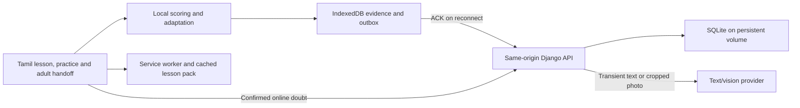

# Architecture and engineering decisions

## Decision

Deploy a same-origin, mobile-first PWA with Django serving the shell and API, native JS modules and CSS for learning, IndexedDB for local progress, Cache Storage for a versioned offline package and SQLite for the single-instance server. Django suits the team's skills and keeps deployment, session security and provider secrets in one service. Keep startup independent of the API. Use Django's supported LTS line and pin the actually tested dependencies in the implementation. Plain remote Django pages would lose the lesson when their server cannot be reached. A static-only PWA moves credential and sync handling to an additional service. A LAN server still requires a reachable host. A native Android build adds packaging and distribution work. A local LLM would introduce device, size and Tamil quality risks. The chosen approach keeps the critical path on-device and gives provider access a small, inspectable server boundary.

## On-device content and execution

- Use an app shell with same-origin JavaScript, CSS and a single versioned pack of authored Tamil text, diagrams, question metadata and answer keys. Include the service-worker entry at an app-root URL so it controls all learning routes. Secure context is required outside localhost. No remote fonts, videos or CDN dependencies in the offline path. Verify glyph availability on the target Android, with a reviewed local font only if needed.
- On first visit, prepare the full shell and one pack while online. App readiness requires both worker control and a successfully read and validated complete pack. Use a cache per release, build-time revision identifiers and explicit required assets. Reject partial installs and retain the active cached release while any client needs it. Updates stage in the background and activate on safe reopen after the current attempt commits. Keep immutable package URLs, reserve a namespaced cache, and remove older caches once safe.
- Cache only the public shell and package on an allowlist. Use a normalized navigation fallback for learning routes. API, CSRF/bootstrap responses, photos and tutor replies are network-only and private/no-store. Offline session and profile selection use local sample data. Keep the initial compressed shell and pack at or under 500 KiB and verify a cold run. Treat this as a prototype budget. Physical Android test target is one basic device with roughly 2 GB RAM if available. Record the actual model, OS and browser.
- Use IndexedDB transaction completion as the point of success. Request persistent storage where supported after a learner action. Storage can be denied, evicted or cleared. Surface quota/storage errors with retry. Keep previous committed progress on failed write and avoid showing new evidence as saved. Recovery from origin data loss is out of scope.
- Run practice, feedback, path selection and both progress views without network. Initial acquisition and AI/photo require connectivity. Flush while app is open on startup, explicit Retry, visibility return or an online signal. Use the HTTP result as evidence of reachability. Background Sync can be an enhancement if needed. [Service worker lifecycle](https://developer.mozilla.org/en-US/docs/Web/API/Service_Worker_API/Using_Service_Workers) · [Browser storage](https://web.dev/learn/pwa/offline-data) · [Background Sync support](https://developer.mozilla.org/en-US/docs/Web/API/Background_Synchronization_API)

## Identity and data model

Use three fictional aliases. Generate random pseudonymous install and profile IDs, with aliases held locally. Client stores use profile-scoped keys and clear temporary tutor, draft and camera state on switch. Apply the same scoping in every selector. The adult handoff shows the active learner only and returns to the learner session. This is cooperative household sharing for synthetic profiles. Local browser data is accessible to someone with control of the device. A real pilot needs a reviewed access policy.

| Store | Contents and invariants |
| --- | --- |
| Package manifest and JSON | packVersion, policyVersion, curriculumRef, objectives, concepts and prerequisites, item IDs, difficulty, item family, expected response, distractor probes, explanation and alternate intervention IDs. IDs stable within a version. |
| IndexedDB profiles | `profileId`, local alias/icon, current run ID and active item instance. Save cursor and accepted response transactionally with events. |
| IndexedDB events and outbox | Immutable `eventId`, `profileId`, `itemInstanceId`, per-profile sequence, `packVersion`, `policyVersion`, item ID, action/response as enumerated choice or bounded signed integer, hint use and optional intervention link. Store event and pending marker together. No photos, chat or device fingerprint. |
| IndexedDB projections | Derived mastery/status, active hypotheses, intervention outcomes and resume reason. Either replay an ordered log or keep a versioned projection rebuilt from evidence. |
| Django install binding | On first reachable flush issue a random server-side install credential in a Secure/HttpOnly/SameSite cookie with CSRF protection. One installation may register its fictional profiles; server scopes all writes to its install and profiles. Profile UUID possession alone grants no access. Creation of an offline attempt never depends on session bootstrap. Preserve pending events and show a recoverable sync error if credentials fail. |
| SQLite sync events | Immutable copy of minimal event data scoped by install and profile, unique `(install, eventId)` and `(install, profileId, sequence)`. Record receipt time. Avoid teaching projections in Python during MVP so local and server logic do not diverge. |

A submitted practice item instance is consumed at most once. A reopen restores the next item; one interrupted or duplicate tap produces one committed attempt. Compute the next cursor and projection from the committed state inside the same transaction, including a check that the submitted item instance still matches. Two tabs with stale item state recover by re-reading current state. Runs need a fresh instance per encounter, so repeating an item during revision can count under the policy.

## API and synchronization

| Contract | Behavior |
| --- | --- |
| `POST /api/session` | Establish the same-origin installation binding and return readiness. Serialize bootstrap on the client to avoid multiple credentials in competing tabs; use one tab as the active sync writer where practical. |
| `POST /api/progress/events` | Accept schema-validated batches of at most 25 events for registered synthetic profiles. Return per-event accepted/duplicate IDs and permanent rejection reasons. Exact retries acknowledge without inserting. A reused ID with different values, invalid schema, or conflicting sequence is a permanent error. Unknown or forbidden install/profile rejects the data. |
| `POST /api/tutor` | Accept bounded question, pack/concept ID and short signal from active learner. Client sends current prompt and optional validated equation. Return Tamil structured tutoring or recoverable fallback indication. |
| `POST /api/photo/transcribe` | Accept a single explicitly submitted cropped JPEG. Return a normalized candidate equation or an unclear/unsupported status. The learner confirms or edits in the UI before tutor submission. |

Outbox delivery is at-least-once, writes are idempotent and acknowledgments are per-event. Drop pending markers only after exact acknowledgments, preserving evidence for local replay. A lost HTTP response and duplicate tab flush must converge without losing work. Serialize client batches per install where possible. Out-of-order arrivals can be stored by sequence; they do not rewrite local history. Permanent validation failures stay visible for development triage and do not stall unrelated events. Keep archived pack/policy versions readable during the hackathon so queued events can reconnect after deploy. For an incompatible update, preserve old immutable items or soft block migration while an attempt is active. No cloud-to-device merge in MVP.

## Online tutor and photo

- Start with a server-side OpenAI text/vision adapter configured by environment. Confirm actual model access, price, retention, event rules and Tamil output with synthetic fixtures. Prefer one compact request and a bounded response. Keep server-origin keys only, and provide a deterministic authored fallback when unavailable. Use an adapter boundary that can be replaced if organizer tooling or account access requires another supported option. The Gemini developer terms restrict under-18-directed clients. [Gemini Developer API terms](https://ai.google.dev/gemini-api/terms) · [OpenAI vision](https://developers.openai.com/api/docs/guides/images-vision)
- Use a narrow schema such as `hintTa`, `briefExplanationTa`, `checkQuestionTa`, optional bounded equation/step fields and a supported/out-of-scope indicator. Pack-grounded prompts instruct short natural Tamil, a next step before a final answer, and one learner-check question. Include only the current concept and a short structured signal such as which inverse operation was confused. Do not pass profile identifiers, raw history or autonomous tools. Chat is transient. Treat learner input, uploaded equations and all model output as untrusted content. Render output as text. Check scope, type, size, math fields and language plausibility before display. The authored answer key is the authority. If model numbers or transformations fail validation, deliver a reviewed hint instead. Out-of-scope or unsafe requests get a short age-appropriate redirection using vetted Tamil copy.
- Use separate capture and gallery controls with Tamil labels. Mobile capture is a browser hint. Preview and crop to one equation, reject non-image and undecodable inputs, downscale to about 1280 px longest edge and re-encode JPEG to strip metadata. Target no more than 500 KiB per upload, with a server hard cap and no raw image persistence. Check dimensions and allowed media type server-side. One retry at the learner's request. Avoid photos containing names/faces. Confirm the recognized equation by tap/edit, and never submit automatically when reconnecting. Denial, ambiguous extraction or failure offers retake and tap starters. Tamil speech is deferred pending device and language testing. [HTML Media Capture](https://www.w3.org/TR/html-media-capture/) · [SpeechRecognition](https://developer.mozilla.org/en-US/docs/Web/API/SpeechRecognition)
- Bound requests by install/session and server limits. Start with 300 input characters for typed doubts, 250 model output tokens, one in-flight request per active profile and a 12-second text or 20-second photo timeout, to revise after measurements. Cancel or ignore late replies after profile switching. Never log image, chat text, precise student attributes or provider payloads. Set supported no-store request options and review provider retention separately. The demo is operated by adults with synthetic accounts, questions and equation photos. Any pilot with real students needs provider-compliant protections, retention review, an appropriate lawful basis and under-age settings, and separate authorization. [Under-18 API guidance](https://developers.openai.com/api/docs/guides/safety-checks/under-18-api-guidance) · [API data controls](https://developers.openai.com/api/docs/guides/your-data)

## Deployment

Use a single HTTPS deployment with application secrets via environment settings, production security settings, persistent local database storage and a release command for migrations. Serve static assets with versioned URLs. Verify fresh and returning installs on the public demo URL and pre-stage sample profiles and known synthetic photo fixtures. Log request status, timings, byte counts and sync acknowledgments without payloads. Measure compressed pack bytes, median and p95 latency on the rehearsal network, estimated inference cost and durable event count after replay. Local development is possible without credentials through the offline slice and authored fallback.
